# Manual do Usuário — Camplana

O **Camplana** ajuda a Dom Rock a planejar campanhas de comissionamento antes de colocá-las em prática. A Gerente descreve a campanha em linguagem natural para a **Lana**, a agente de IA do sistema. A Lana preenche os parâmetros e simula quanto a campanha custaria sobre as vendas reais. Depois, a campanha passa pela aprovação de um Supervisor e pode ser consultada por um Auditor.

**Nenhum número vem direto da IA.** A Lana gera o código Python da regra, que roda isolado sobre os dados e é conferido contra um cálculo determinístico.

Este manual vale para a versão do fim da Sprint 3 e está organizado por perfil. Para instalar o sistema, veja o [Manual de Instalação](manual-instalacao.md).

Prefere ver funcionando? O [vídeo tutorial](https://youtu.be/GkWMWjIWTaI) mostra o fluxo completo da Sprint 3, da Gerente ao Auditor, em cerca de 5 minutos. Os pedidos de correção da base e de intercorrência pela Lana, com a aprovação em **Solicitações**, estão [neste outro vídeo](https://youtu.be/Rg16uMSsVQw), de cerca de 3 minutos.

---

## Sumário

1. [Perfis e acesso](#1-perfis-e-acesso)
2. [Gerente de Vendas](#2-gerente-de-vendas)
3. [Supervisor de Vendas](#3-supervisor-de-vendas)
4. [Auditor](#4-auditor)
5. [Administrador](#5-administrador)
6. [Ciclo de vida de uma campanha](#6-ciclo-de-vida-de-uma-campanha)
7. [Em desenvolvimento](#7-em-desenvolvimento)

---

## 1. Perfis e acesso

| Perfil | O que pode fazer | Tela inicial |
|---|---|---|
| **Gerente de Vendas** | Criar campanhas conversando com a Lana, simular, publicar para aprovação e acompanhar as próprias campanhas; pedir à Lana correções da base e intercorrências de RH | Nova Campanha (chat) |
| **Supervisor de Vendas** | Tudo da Gerente, mais aprovar ou devolver campanhas de outras pessoas, decidir os pedidos de correção e de intercorrência de outras pessoas e importar a base mensal | Nova Campanha (chat) |
| **Auditor** | Consultar, sem alterar, as campanhas, versões, conversas e decisões de todos; ver o SQL e o código gerados; abrir e resolver alertas técnicos | Auditoria |
| **Administrador** | Só a gestão de usuários. Não vê campanhas nem simulações | Usuários |

### 1.1 Entrar no sistema

1. Abra o endereço do sistema no navegador (na instalação local, `http://localhost:5173`).
2. Informe o e-mail e a senha e clique em **Entrar**.
3. O sistema abre a tela inicial do seu perfil.

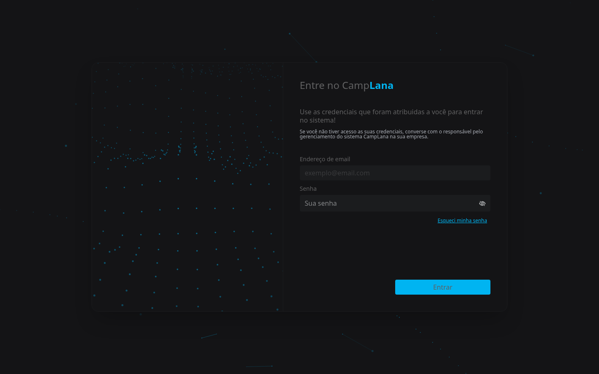

Na demonstração, todos usam a senha `123456`: `gabriela` (Gerente), `sergio` e `silvia` (Supervisores), `paulo` (Auditor) e `ana` (Administradora), sempre com `@camplana.com.br`.

Para sair, clique no ícone de desligar, ao lado do seu nome, no canto inferior esquerdo.

---

## 2. Gerente de Vendas

### 2.1 Descrever a campanha para a Lana

1. No menu lateral, clique em **Nova Campanha**.
2. Escreva a campanha no campo de mensagem e tecle **Enter**. Exemplo:
   > Quero uma campanha de Black Friday de 23/11/2026 a 29/11/2026: +1% de comissão para todas as marcas e cargos, exceto gerentes (cargo 150), com meta de R$ 2.000.000 e orçamento de R$ 30.000.
3. A Lana responde no chat e preenche o painel **Simulação**, à direita. Se faltar alguma informação, ela pergunta, sem inventar valores.

Cada conversa trata de uma única campanha. Suas conversas ficam em **Seus Chats**, no menu lateral.

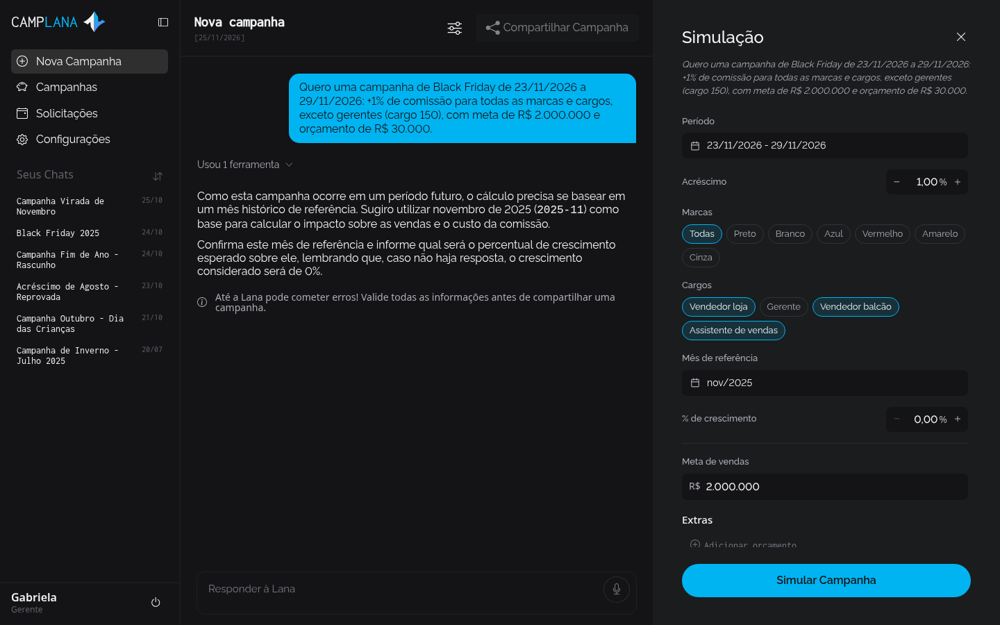

### 2.2 Campanha num mês futuro (novidade da Sprint 3)

A base tem vendas de julho a dezembro de 2025. Para uma campanha num período sem dados, como a Black Friday de 2026, a Lana:

1. sugere um **mês de referência** de 2025 (no exemplo, novembro de 2025);
2. pergunta o **% de crescimento** das vendas sobre esse mês. Sem resposta, vale 0%.

O cálculo usa as vendas reais do mês de referência ajustadas pelo crescimento. Isso não é uma previsão de vendas.

### 2.3 Revisar os parâmetros

No painel **Simulação**, confira e ajuste o que precisar antes de simular:

| Campo | O que é |
|---|---|
| **Período** | Datas de início e fim da campanha |
| **Acréscimo** | Pontos percentuais somados à comissão (botões `−` e `+` de 0,1 em 0,1) |
| **Marcas** | Marcas participantes, ou **Todas** |
| **Cargos** | Cargos que recebem o acréscimo |
| **Mês de referência** e **% de crescimento** | Só em campanhas de período futuro (seção 2.2) |
| **Meta de vendas** | Volume de vendas esperado, em R$ |
| **Extras** | Orçamento máximo da campanha, opcional (**Adicionar orçamento** / **Tirar o orçamento**) |

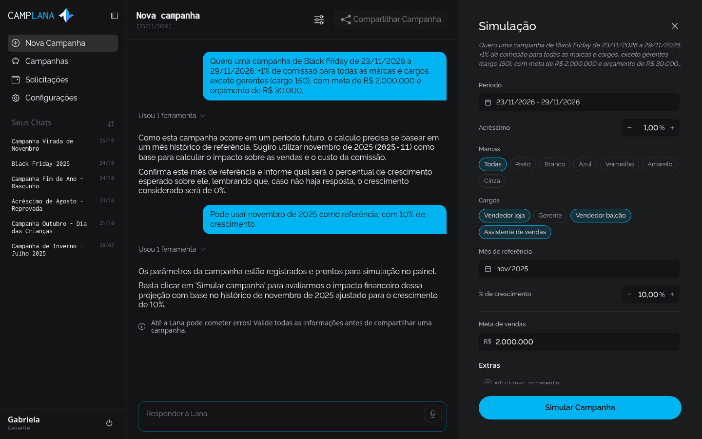

### 2.4 Simular

1. Clique em **Simular Campanha**.
2. A Lana gera o código da regra, executa num ambiente isolado e confere o resultado. Leva de alguns segundos a cerca de um minuto.
3. O resultado aparece no chat:
   - **Meta:** quanto as vendas do período representam da meta;
   - **Custo extra** da campanha sobre a comissão atual e se ele **cabe no orçamento**;
   - **Pessoas** que recebem o acréscimo e o valor médio;
   - **Onde o custo pesa:** por marca, por cargo e pelas lojas de maior custo;
   - **Outros cenários, já simulados:** por exemplo, o maior acréscimo que ainda cabe no orçamento. **Usar no painel** copia o cenário para os parâmetros.

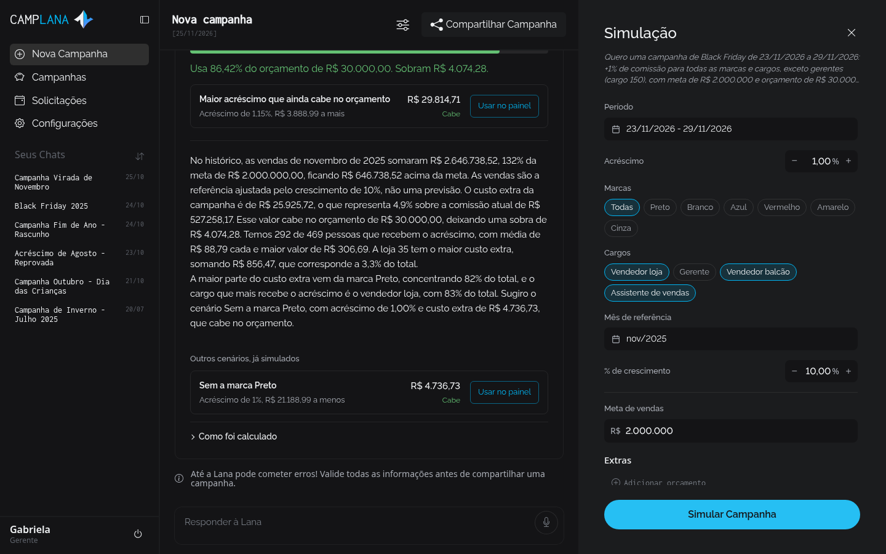

### 2.5 Quanto cada pessoa recebe (novidade da Sprint 3)

Abaixo do resultado, o **detalhamento por pessoa** lista cada funcionário com matrícula, cargo, loja, base de cálculo, % aplicado e os **ajustes** das regras da especificação que valeram para ele. Use **Anterior** e **Próxima** para navegar.

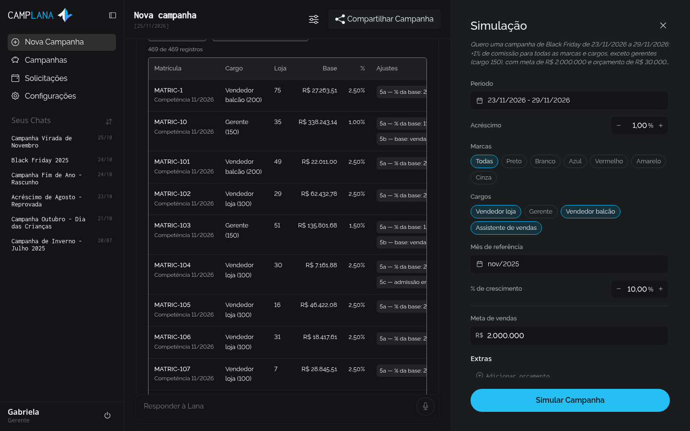

### 2.6 Como foi calculado

Clique em **Como foi calculado** para ver de onde vieram os números:

- se o resultado da IA bateu com o cálculo determinístico;
- as premissas da simulação (por exemplo, que as pessoas venderiam o mesmo que no período de referência);
- as regras da especificação aplicadas (5a a 5g);
- as **intercorrências de RH** (afastamentos, férias, desligamentos). Só as já aprovadas entram na apuração; as pendentes ficam de fora e a tela avisa (novidade da Sprint 3).

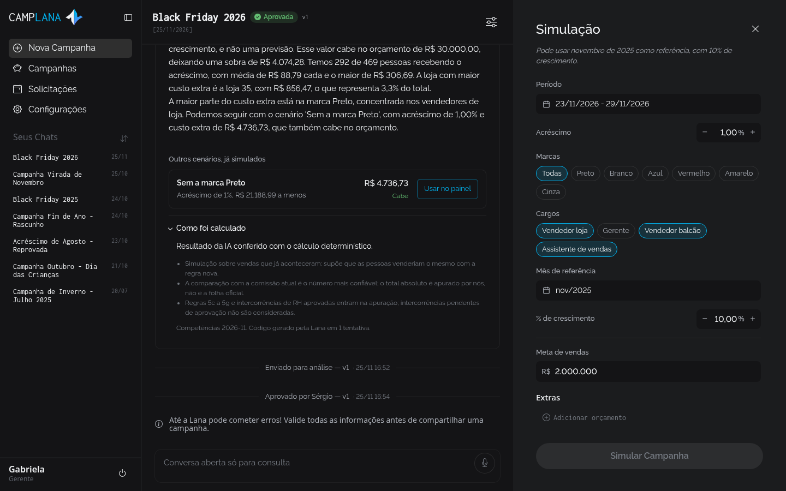

O SQL e o código Python gerados pela Lana aparecem só para o Supervisor e o Auditor (novidade da Sprint 3).

### 2.7 Publicar para aprovação

1. Com uma simulação concluída, clique em **Compartilhar Campanha**, no topo do chat.
2. Dê um nome à campanha e clique em **Publicar**.
3. A campanha congela a versão atual (parâmetros, resultado e conversa) e entra na fila dos Supervisores como **Aguardando aprovação**.

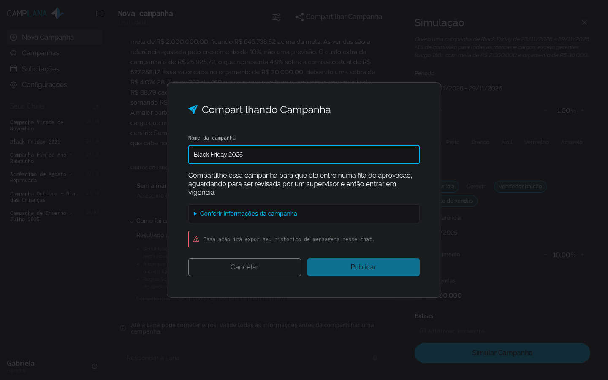

### 2.8 Acompanhar as campanhas

No menu **Campanhas**, a tela **Minhas Campanhas** lista as suas campanhas com período, status, versão, custo adicional e data da última alteração. Filtre por **Rascunho**, **Aguardando**, **Aprovada**, **Reprovada** ou **Arquivada**. Clique numa campanha para abrir a conversa dela.

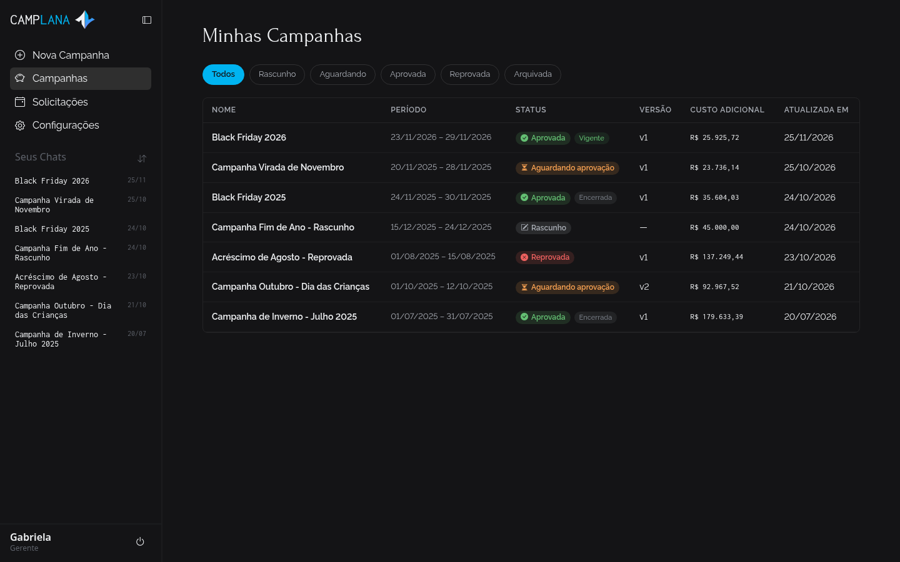

### 2.9 Eventos no chat (novidade da Sprint 3)

O chat da campanha mostra o que aconteceu com ela, na ordem: **Enviado para análise** e depois **Aprovado por** ou **Reprovado por** (com o comentário do Supervisor), sempre com a data. Depois de aprovada, a conversa fica **aberta só para consulta**.

Se o Supervisor devolver a campanha, o comentário dele aparece no chat. Continue a conversa, ajuste os parâmetros, simule de novo e publique: a campanha volta para a fila como versão 2.

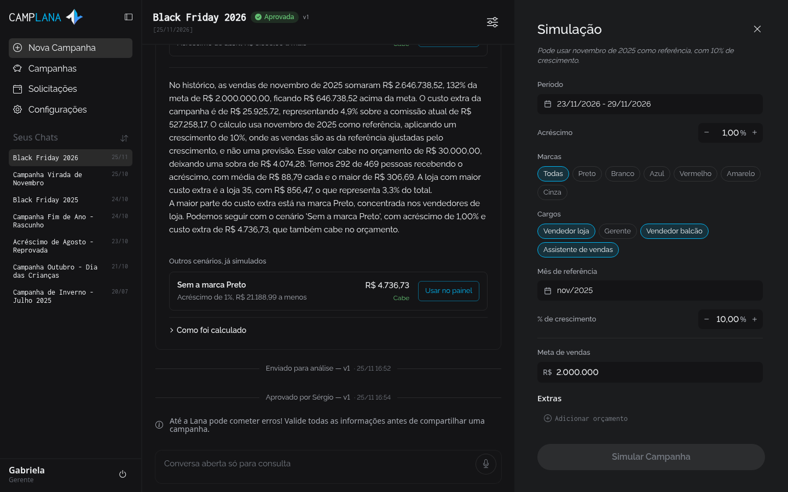

### 2.10 Pedir uma correção da base ou uma intercorrência pela Lana (novidade da Sprint 3)

Quando um dado da base estiver errado, ou houver uma intercorrência de RH, peça no próprio chat, em linguagem natural. Não há formulário.

- **Correção da base:** transferência de loja, troca de cargo, data de admissão ou data de demissão. Diga a matrícula, o valor novo, o mês e o ano em que a correção vale (a competência) e o motivo. O valor atual é opcional: a Lana busca na base. Ex.: "A MATRIC-38 foi transferida da loja 33 para a loja 8 em outubro de 2025; foi transferência a pedido da regional."
- **Intercorrência de RH:** férias, afastamento, licença-maternidade, cobertura de loja ou demissão. Diga a matrícula, o período (a demissão tem uma data só), o motivo e, na cobertura, a loja. Ex.: "A MATRIC-12 vai tirar férias de 01/12/2025 a 15/12/2025, férias programadas."

Antes de montar o pedido, a Lana confere os dados na base:

- se o valor atual que você informou não bater com a base, ela avisa qual é o valor certo e não abre o pedido;
- se você não disser o mês, ela pergunta a competência antes de abrir;
- se a matrícula não existir, ou a data final vier antes da inicial, ela recusa;
- se o pedido for, na verdade, uma mudança de % de comissão, ela explica que isso é uma campanha.

Com tudo certo, a Lana mostra um **cartão** com o tipo, a matrícula, o valor anterior e o novo (ou o período, na intercorrência), a competência e o motivo. Você pode alterar o motivo no próprio cartão.

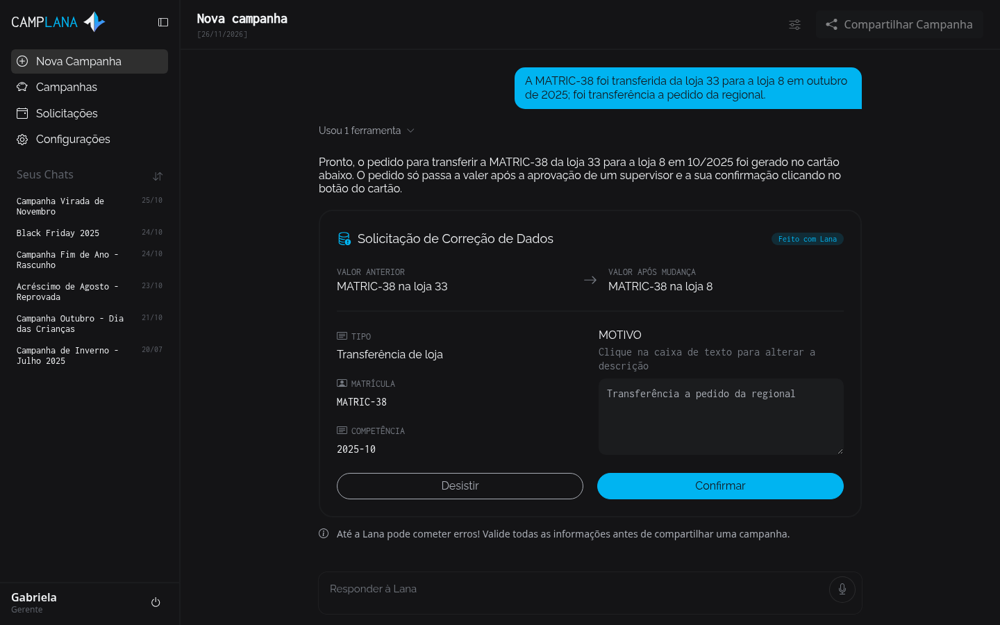

- **Confirmar** envia o pedido para a fila de Solicitações como **Pendente**. A base **não** muda ainda: ela só muda quando outra pessoa aprovar.
- **Desistir** descarta o cartão, e nenhum pedido é criado.

### 2.11 Acompanhar os pedidos (novidade da Sprint 3)

No menu **Solicitações**, a seção **Meus pedidos** lista os pedidos que você abriu, com motivo, tipo, competência, matrícula, status (**Pendente**, **Aprovado** ou **Reprovado**) e a justificativa de quem reprovou. As abas **Correção da Base** e **Abertura de Intercorrência** separam os dois tipos. Clique num pedido para ver os detalhes.

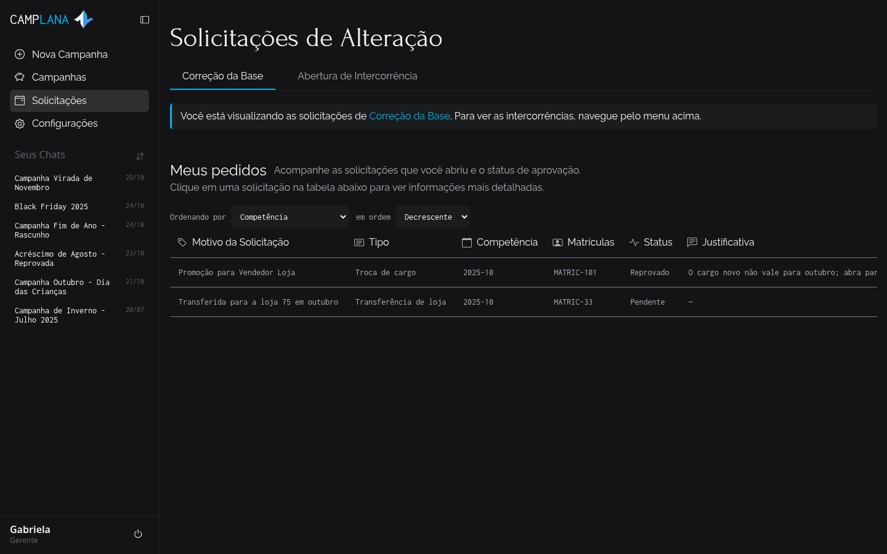

---

## 3. Supervisor de Vendas

O Supervisor faz tudo o que a Gerente faz (seção 2) e também decide sobre as campanhas e os pedidos de correção e de intercorrência, e importa a base mensal.

### 3.1 Fila de aprovação

No menu **Campanhas**:

- **Aguardando Aprovação** mostra um cartão por campanha pendente, com período, acréscimo, custo extra, conflitos com outras campanhas, autor e data de envio;
- **Campanhas aprovadas** separa as aprovadas em três abas (novidade da Sprint 3):
  - **Realizadas:** o período já terminou;
  - **Em andamento:** o período inclui o dia de hoje;
  - **Previstas:** o período ainda não começou.


### 3.2 Analisar e decidir

Clique num cartão para abrir o painel **Visualizando Campanha**: resumo da Lana, link para o chat, parâmetros, custo e as campanhas que conflitam no mesmo período. As ações são:

- **Aprovar:** a campanha passa para **Aprovada**;
- **Devolver campanha:** escreva o comentário (obrigatório) explicando o que ajustar. A Gerente vê o comentário no chat;
- **Simular de novo:** recalcula a versão considerando as campanhas aprovadas depois do envio. Se outra campanha do mesmo período foi aprovada depois que esta foi enviada, o sistema exige simular de novo antes de aprovar.

A aprovação é feita por **outra pessoa**: o Supervisor não decide uma campanha que ele mesmo criou.

### 3.3 Alerta técnico trava a aprovação (novidade da Sprint 3)

Se a versão tiver um **alerta técnico aberto**, o painel avisa e o botão **Aprovar** não aparece. Só o Auditor resolve o alerta (seção 4.4). Devolver a campanha continua possível.

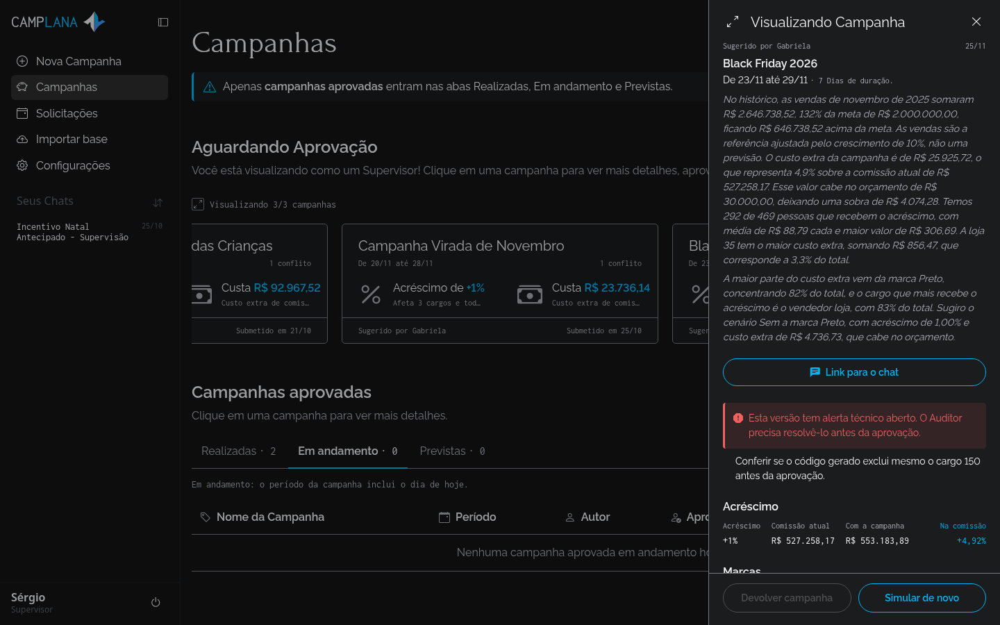

Depois de aprovada, a campanha aparece na aba correspondente ao período:

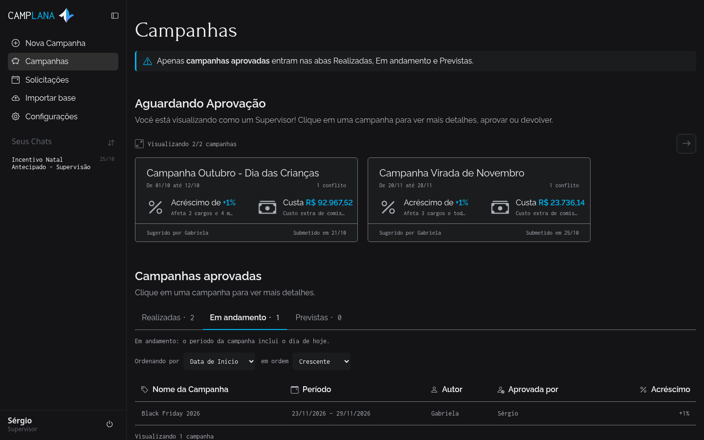

### 3.4 Importar a base do mês

No menu **Importar base**:

1. Arraste as planilhas `.xlsx` do mês ou clique para escolher. O nome do arquivo diz o tipo e o mês: `BASE RH_OUT25.xlsx`, `BASE_VENDAS_OUT25.xlsx` e `BASE_COMMISS_OUT25.xlsx`. RH e Vendas são obrigatórias; a Comissão é opcional. Vários meses podem ir de uma vez.
2. Clique em **Importar**.
3. O **Histórico de envios** mostra cada envio com competência, data, quem enviou, situação e linhas gravadas. Clique em **Ver relatório** para as pendências:
   - **aviso:** não impede a carga (por exemplo, funcionário sem vendas no mês);
   - **impeditiva:** nada é gravado. Corrija a planilha e envie de novo.

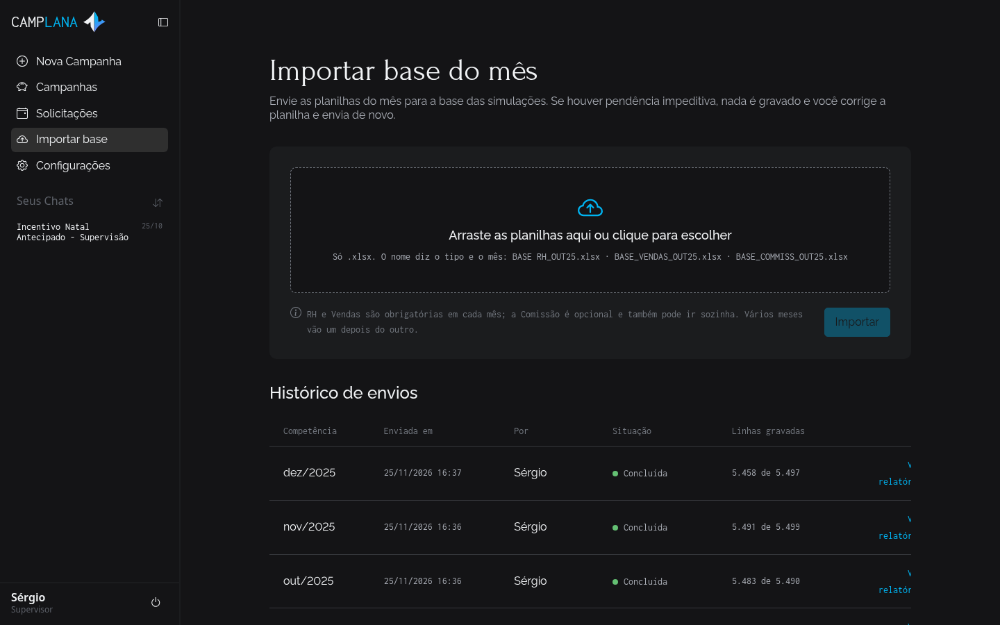

### 3.5 Decidir pedidos de correção e de intercorrência (novidade da Sprint 3)

No menu **Solicitações**, escolha a aba **Correção da Base** ou **Abertura de Intercorrência**. A fila mostra um cartão por pedido pendente de **outras pessoas**, com o tipo, a competência, a matrícula, o motivo, o valor anterior e o novo, e quem abriu. Pedidos feitos pelo chat trazem a marca **"Aberta pela Lana a pedido de"** e o nome de quem pediu. Use as setas para passar de um pedido para outro.

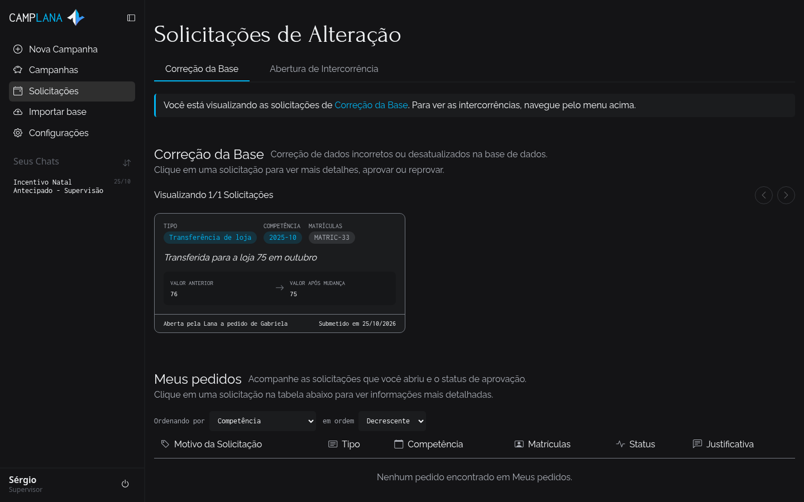

Clique num cartão para abrir os detalhes e decidir:

- **Aprovar:** a correção é aplicada na base na mesma hora (a intercorrência passa a valer na apuração), e o pedido fica **Aprovado**;
- **Reprovar:** escreva a justificativa (obrigatória) e confirme. A base não muda, e quem pediu vê a justificativa em **Meus pedidos**.

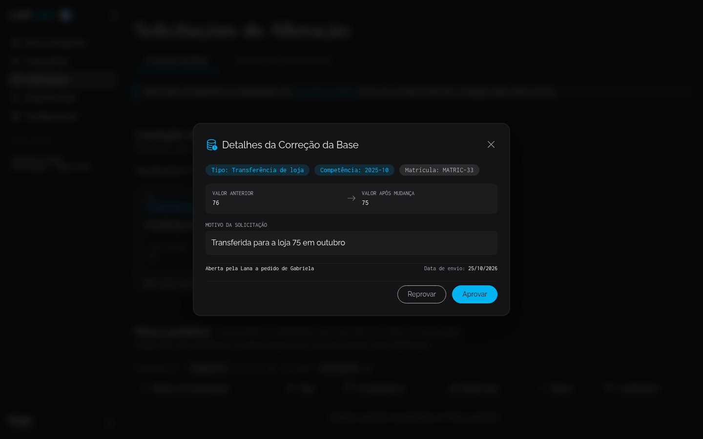

A decisão é sempre de **outra pessoa**: o Supervisor não decide um pedido que ele mesmo abriu. Se a base mudou depois do pedido (por exemplo, outra correção já moveu a matrícula de loja), a aprovação é recusada com o aviso "A base mudou desde o pedido".

---

## 4. Auditor

Perfil novo da Sprint 3. O Auditor consulta tudo, **somente para leitura**: não cria, não simula, não aprova. A única ação dele é abrir e resolver alertas técnicos.

### 4.1 Lista da Auditoria

O menu **Auditoria** tem duas abas:

- **Campanhas:** todas as campanhas de todos os usuários, com autor, status, período e última alteração. Busque pelo nome ou filtre pelo status;
- **Correções da base:** os pedidos de correção da base cadastral e suas decisões.

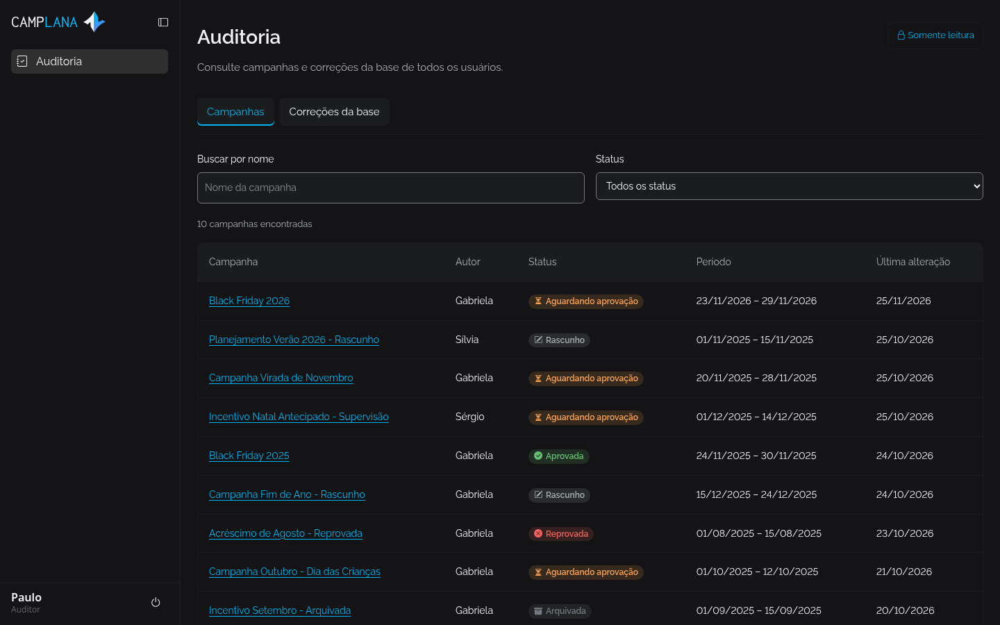

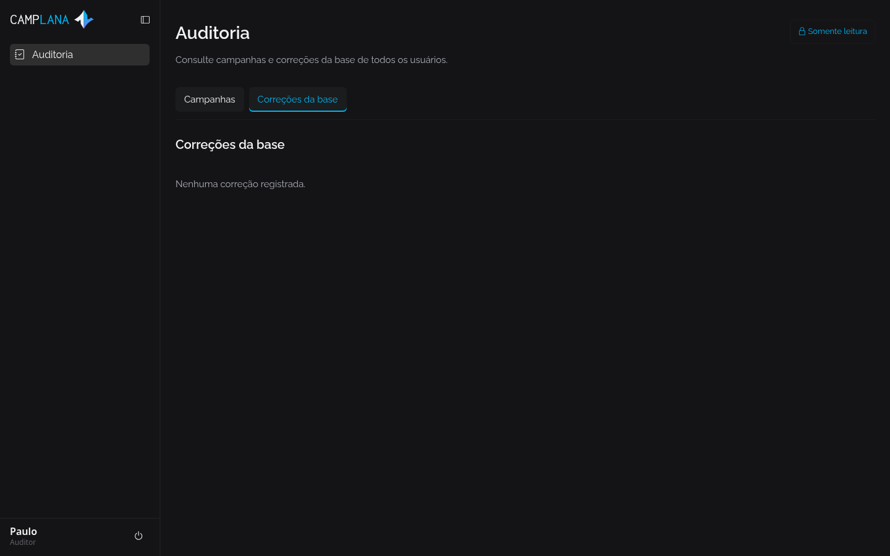

### 4.2 Visão de negócio

Clique numa campanha. O detalhe tem quatro abas:

- **Versões:** parâmetros e resultado de cada versão. Em **Comparar com**, escolha outra versão para ver o que mudou;
- **Decisões:** quem aprovou ou devolveu, quando e com qual justificativa;
- **Conversa:** a conversa inteira entre o autor e a Lana;
- **Técnica:** veja a seção 4.3.

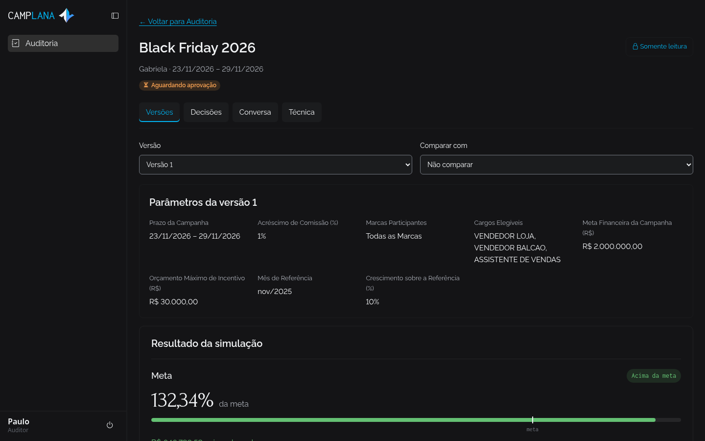

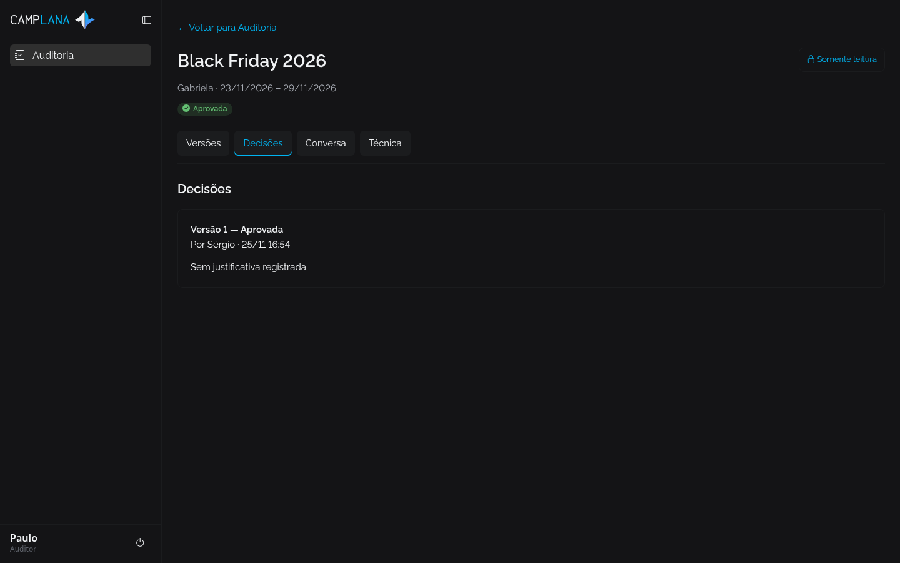

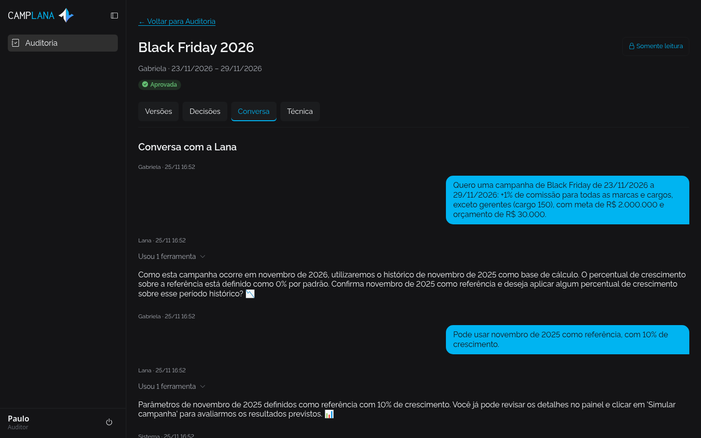

### 4.3 Visão técnica

A aba **Técnica** mostra, para a versão escolhida:

- **Trilha com SQLs executados:** cada passo da Lana, com a ferramenta usada, as tabelas acessadas, as competências, quantos registros voltaram e o SQL executado;
- **Código Python gerado:** o código da regra que rodou na simulação;
- **Alertas técnicos** da versão.

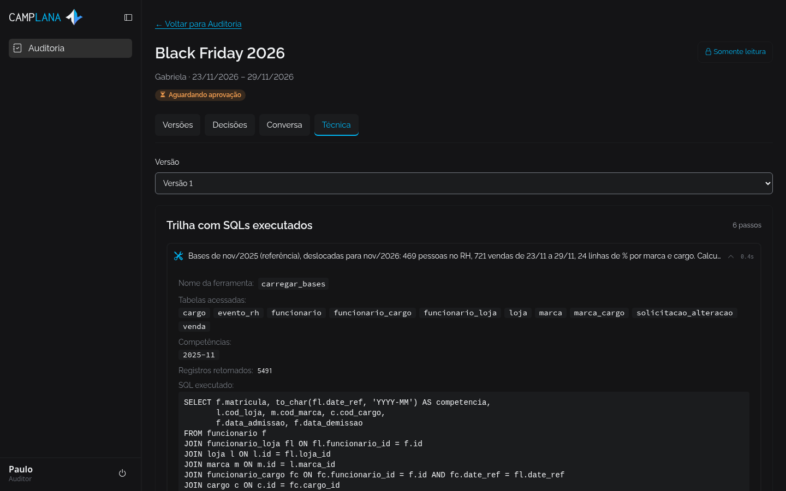

### 4.4 Abrir e resolver alertas técnicos

Um alerta técnico trava a aprovação da versão até ser resolvido. Ele pode surgir de duas formas:

- **automático:** a Lana registra quando bloqueia uma consulta SQL não permitida ou um código Python suspeito;
- **manual:** o Auditor abre quando quer que algo seja conferido antes da aprovação.

Para abrir: na aba **Técnica**, clique em **Abrir alerta**, descreva o problema e confirme.

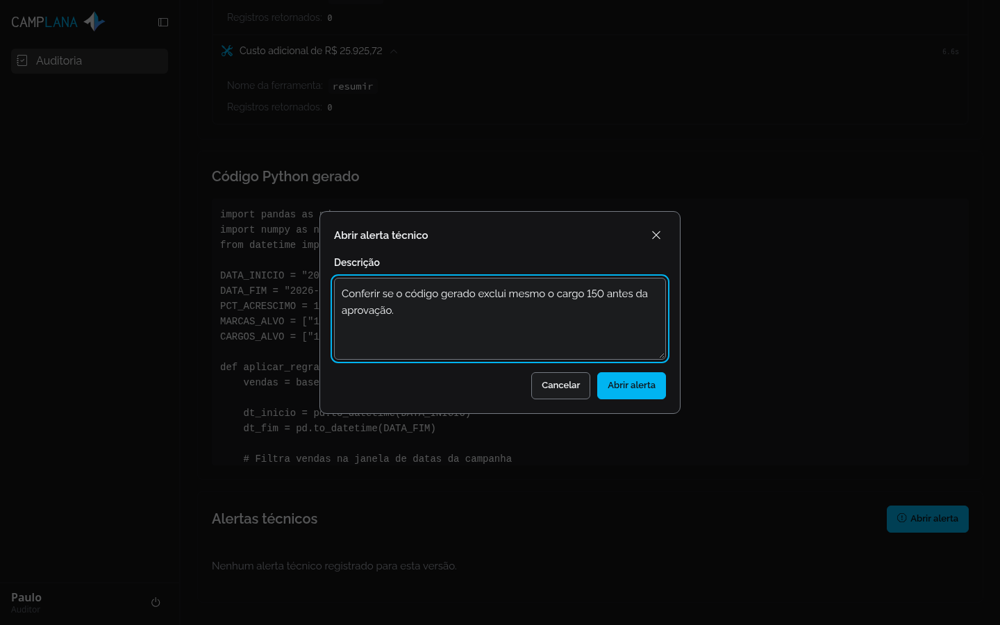

Para resolver: clique em **Resolver alerta** no alerta aberto, escreva a justificativa (obrigatória) e confirme. A partir daí, o Supervisor pode aprovar.

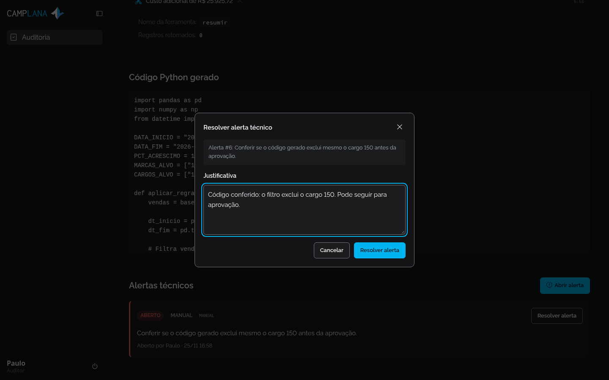

O alerta resolvido continua no histórico, com quem abriu, quem resolveu, quando e a justificativa:

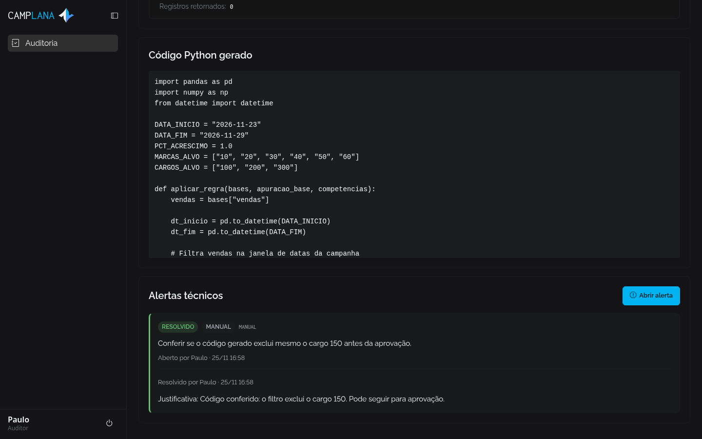

---

## 5. Administrador

O menu **Usuários** lista quem tem acesso, com nome, e-mail, perfil e situação (ativo ou inativo).

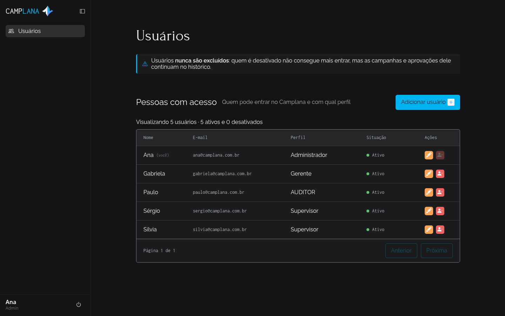

- **Adicionar usuário:** informe nome, e-mail, perfil (Gerente, Supervisor ou Administrador) e uma senha inicial de pelo menos 8 caracteres. A pessoa já entra com essa senha;
- **Editar:** muda os dados e o perfil;
- **Desativar:** a pessoa perde o acesso, mas o histórico dela continua no sistema.

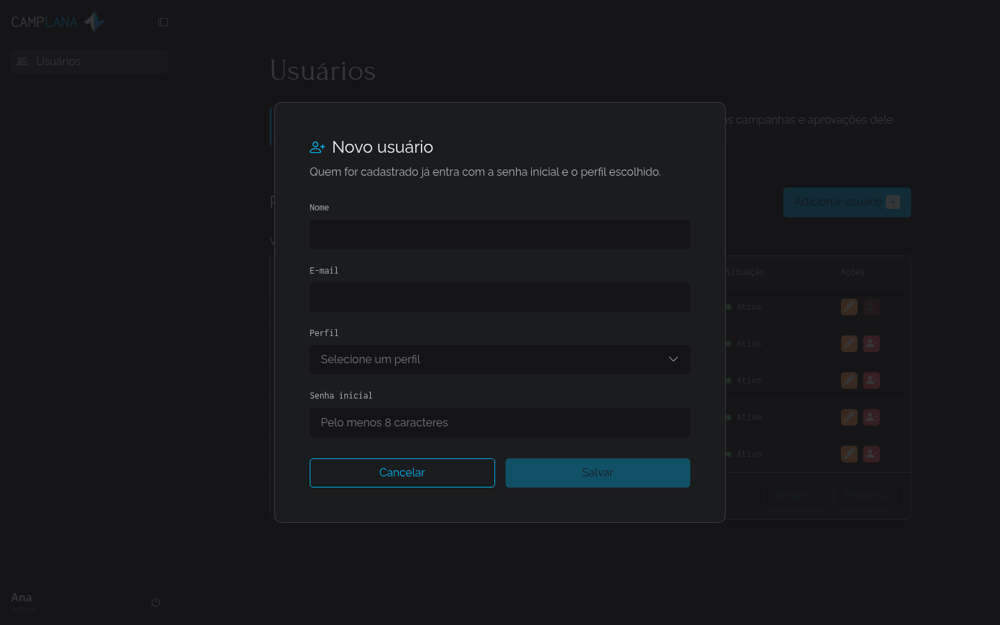

---

## 6. Ciclo de vida de uma campanha

```text
Gerente descreve  ─►  simula  ─►  publica  ─►  AGUARDANDO APROVAÇÃO
                                                │
                     alerta técnico aberto? ────┤ (Auditor resolve)
                                                │
                          Supervisor decide  ───┼──►  APROVADA  ─►  Realizadas / Em andamento / Previstas
                                                │
                                                └──►  DEVOLVIDA  ─►  Gerente ajusta e publica a versão 2
```

Cada publicação congela uma **versão** com os parâmetros, o resultado e a conversa daquele momento. O Auditor consulta todas as versões e decisões.

---

## 7. Em desenvolvimento

Este item ainda não está na versão descrita neste manual:

- escolher o perfil **Auditor** ao cadastrar um usuário. Por enquanto, o único Auditor é o Paulo, criado pela migration V12.

Além das intercorrências pedidas pela Lana (seção 2.10), as da demonstração também entram pela carga do `seed-demo.sh` (veja o Manual de Instalação).
